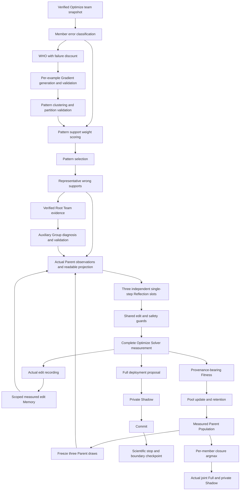

# V2.12 modular mechanisms architecture

Architecture identity: `V212_MODULAR_MECHANISMS_ARCHITECTURE_V1`.
This is a behavior-preserving composition refactor of the current V2.12 method.
It changes source identity, not the normative count responsibility, optimizer
wire, evaluation, admission or stopping rules. The existing V2.12, V2.11 and
population contracts remain authoritative for scientific behavior.

## Composition and decision authority

`build_current_team_prompt_search` remains the sole team composition root.
`UnifiedSearchOrchestrator` owns lifecycle sequencing; it does not choose a
repair, edit a Prompt, score a Parent or admit a proposal itself. `TeamModules`
declares twenty factory ports. `capability_inventory()` additionally describes
existing evidence, provider, validation, state and recovery authorities.

Responsibilities are exclusive member-error labels from five correctness bits.
WHO chooses a member; Pattern selection chooses the repair direction. Gradient
diagnoses observed failures and clustering partitions its supported hypotheses.
Neither owns Pattern weights. The support sampler only chooses existing wrong
supports. Every Parent shares the same Layer2 repair; actual Parent responses
retain distinct provenance from the Root observations.

Group diagnosis supplies auxiliary observations. Root evidence construction,
bounded model generation, source validation and readable projection remain
separate existing authorities. `TeamGroupChannel` handles delivery/accounting
and exposes `generate`; a replacement cannot acquire WHO or editing rights.

`FrozenParentSelection` freezes the complete three-draw plan before any edit.
`ReflectionEvidenceComposition` combines verified evidence, actual Parent
observations, measured Memory and auxiliary Group experience. `SingleStepReflection`
owns bounded generation, parsing and candidate legality; it has no deployment
authority. The two experiment-specific team and single-Prompt generation wires
remain distinct. Shared block editing, capacity arithmetic and content checks
have one implementation.

`ParentPopulation` owns state, uniqueness, scope and persistent plans. Sampling,
three-best retention and final argmax selection are separate strategies.
`PopulationEvaluationProvider` owns actual complete measurement and profile
reuse; Fitness assignment and pool updating are separate policies. Search
retention is independent of Full deployment selection. Private Shadow and the
committer retain exclusive gate/deployment authority. Final assembly proposes
one team and measures it jointly; historical member Fitness is never a substitute.

`PopulationEditMemory` is the only team experience store and recovery authority.
Recording, parent-scoped ranking and whole-card delivery are separate components.
Records remain scoped actual observations, not universal causal rules. The
transaction boundary and recorded measured effects remain unchanged.

## Interfaces, state and legal interventions

The machine-readable inventory names each implementation, input/output contract,
dependencies, roles, data scope, mutable state, decision authority and independent
framework adaptation status. Protocols for Pattern scoring/selection and concrete
strategy ports use the same production objects. Registration validates operation
signatures; population samplers must provide both probabilities and draws.
Registration does not authorize model calls or an experiment.
Runtime boundaries reject incompatible strategy outputs: pool retention stays
unique and bounded, sampling probabilities remain finite/positive/normalized,
draws remain three valid frozen Parents, and assembly selects five pool members.
Replacing Reflection cannot bypass the shared candidate safety and single-block
edit checks. Failed retention validates before mutating the live pool.

The twenty selectable ports use Optimize evidence. Solver measurement remains
Optimize-only; private Shadow separately owns adaptive-gate data. The optimizer
never receives raw Shadow, Validation or Test evidence. Shared validation and
identity checks are safety authorities, not freely disableable scientific knobs.

Default factories preserve current method, binding, composition, cache-lane,
output and checkpoint identities. New source and contract hashes require a fresh
experiment freeze, scope and exact authorization. Preserving semantic identifiers
does not make an old paid checkpoint/cache/authorization executable. Source closure
includes this contract and the new implementations.

Nondefault factories currently require `synthetic_intervention=True` and a live
credential-free offline network guard. They acquire a distinct module binding,
result identity and population scope; they cannot be mislabeled as the default
V2.12 method or restored into it. There is no paid intervention runtime, CLI
algorithm switch or automatic protocol amendment. Future real interventions
require their own normative identity, evaluation plan and governed composition.

Detached restoration retains the actual live sampling, retention, assembly,
recording, retrieval and delivery policies. Plan replay uses the live sampler.
Atomic boundary restoration still verifies profile, Fitness, initial floor,
Memory, history, stopping and source scope before mutating live state.

Explicit synthetic controls exist for Group channel, Reflection generation and
Memory delivery. Group disablement preserves canonical Root safety evidence and
emits `MODULE_DISABLED` with no model call. Reflection disablement emits no
candidate and zero draws; it is a pipeline negative control, not a proposed
optimizer. Memory delivery disablement stores genuine measurements but supplies
no cards; it isolates delivery, not all recording/storage behavior.

`NO_SUPPORTED_INSIGHT` is a valid model diagnosis; `MODULE_DISABLED` is an
experimental control; `GENERATION_FAILED` means bounded typed output exhaustion.
Provider/integrity/unknown runtime failures remain fatal and are not regenerated
or converted to any of those successful continuation states.

No silent fallback replaces a missing upstream mechanism. Disabling Gradient
requires a separately specified lawful repair-direction control before Pattern
or Reflection can run. Other ports can be replaced by compatible registered
strategies, but no scientifically meaningful disabled control is claimed for them.

## Independent single-Prompt framework

The existing `research/ablations` registry and `binding / initial_state / prepare /
observe` kernel remain the only independent module framework. Formal diagnostics,
bounded recovery, partition normalization and safety checks are reused through
`formal_adapters`. Team selection uses weighted responsibility; independent
selection uses the explicitly named largest unique support selector. Normalization
does not invoke team scoring with fabricated labels or a zero-weight fallback.

The historical synthetic `formal_gradient` adapter was an interface prototype
with a preselected diagnostic Batch. The user-requested [module-flow audit](SINGLE_PROMPT_MODULE_ALIGNMENT_V6.md)
disables it in the current registry; its class is not a runnable scientific arm.
Current independent controls retain their approved kernel and use full discovery
only through the reviewed complete Gradient Pattern adapter.

WHO, Group diagnosis, plurality, Full/Shadow, final team assembly and team stopping
are intrinsically team mechanisms. Independent reuse would require a different
scientific context and cannot fabricate five members. Team Memory storage is not
registered as a runnable independent module: honest member-only measured effects,
scope and delivery semantics must be specified first. No dummy Team Vote/Shadow
cards are introduced. Source-bound independent module bindings change with new
implementation hashes; frozen historical plans and authorizations remain immutable.

## Verification and interpretation

Default equivalence requires full model payloads, intermediate repair decisions,
Parent plans, candidates, Memory, evaluations, commits, final state, stopping,
checkpoints, role calls and token counters under fixed fabricated inputs. Only
dispatch order inside concurrent independent Solver batches is unspecified;
comparisons preserve complete payload multiplicity and optimizer call order.
Recovery and errors require dedicated guarded tests in addition to successful runs.

Synthetic equivalence is finite witness evidence, not a proof for all inputs or
provider timing. Modularization and mock connectivity establish no real candidate
quality, Team Vote, Token efficiency or generalization improvement. No real
ablation is authorized by this architecture contract.
